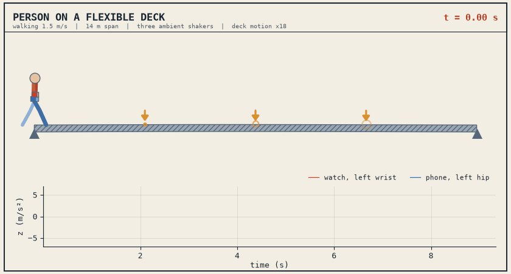

# Human-carried indirect sensing

**Jovdat Babazade and Furkan Lüleci** · Louisiana State University

A person carries a smartwatch and a smartphone across a flexible deck. This code simulates the person and the deck together and records what the devices measure.



| | |
|---|---|
| Paper | Indirect Sensing of Civil Structures through Human-Carried Mobile Devices: Effects of Structural Properties, Excitation, and Sensor Noise. Babazade and Lüleci, under review. |
| Pages | [covdetbaba.github.io/human-carried-indirect-sensing](https://covdetbaba.github.io/human-carried-indirect-sensing/) |
| Authors | Jovdat Babazade and Furkan Lüleci (supervisor), Department of Civil and Environmental Engineering, Louisiana State University |
| License | All rights reserved. Free to run and study with credit. See [LICENSE](LICENSE). |

## 1. What is modelled

**Deck.** Any flexible deck a person walks or stands on: a floor slab, a footbridge, a walkway. It is a simply supported OpenSeesPy model. The baseline is a 14 m concrete slab, 3 m wide and 0.2 m thick.

**Person.** Five masses (two hips, torso, two wrists) in three directions, 15 DOF in total. The walk includes the step force, step timing and arm swing. The person can also stand still at mid-span.

**Coupling.** Person and deck are solved together in every time step.

**Devices.** A watch on each wrist and a phone on each hip, all triaxial, with sensor noise.

**Excitation.** Three ambient shakers on the deck, plus the person.

**Output.** For each configuration: the deck spectrum under the shakers alone, and the spectrum of each device over 20 records. The same walk on a rigid floor is kept for comparison.

**Person's own lines.** The gait comb, arm swing, body modes and crossing rate are listed for every record, so a device peak can be told apart from the deck.

**Observability index.** Each deck mode is scored on each device:

OI = 100 · G · (F · P<sub>own</sub> · P<sub>bg</sub>)<sup>1/3</sup>

F is frequency agreement with the deck mode, P<sub>own</sub> the peak's prominence on the device curve, P<sub>bg</sub> its height over the rigid-floor curve, and G is zero when the device curve does not rise above the rigid floor in the mode's band. A mode is unobservable below 27.5 and observable from 92.3.

## 2. Explorer

Three graphs: the deck, the smartwatch and the smartphone. For the swept parameter you can

- click a peak on the deck graph to select a mode. It snaps to the nearest maximum and is checked on both devices.
- pick a deck mode from the buttons and see its shape move in 3D. Stop or play it, and drag to rotate.
- switch on the gait lines to see which device peaks come from the person.
- read the observability index of every mode, with captured modes marked on the curves.
- switch on the rigid-floor curves.
- change the display smoothing. 0 turns it off. The index is scored at 0.06 Hz.
- show or hide all curves at once.

## 3. Pages

| Page | What it shows |
|---|---|
| [Explorer, walking](https://covdetbaba.github.io/human-carried-indirect-sensing/explorer-walking.html) | 10 parameters, every pair stored. Spectra, mode selection, mode shapes, gait lines, observability index. |
| [Explorer, standing](https://covdetbaba.github.io/human-carried-indirect-sensing/explorer-standing.html) | The same for a person standing at mid-span. |
| [Animations](https://covdetbaba.github.io/human-carried-indirect-sensing/walk-2d.html) | Walking and standing, side view and 3D. |

## 4. Run it

Linux, macOS or WSL, Python 3.10 or newer.

```bash
git clone https://github.com/covdetbaba/human-carried-indirect-sensing.git
cd human-carried-indirect-sensing
pip install -r requirements.txt
cd src
```

Open the explorer locally. Combinations that are not stored are computed when you ask for them.

```bash
python3 explorer.py --serve
```

Then open http://localhost:8770. Add `--standing` for the standing study (port 8771).

Other commands:

```bash
python3 explorer.py --rebuild     # rebuild the page from data/
python3 explorer.py               # run the whole walking study again (long)
python3 animations.py             # rebuild the animation pages and the GIF
```

## 5. Files

| File | Role |
|---|---|
| `src/human_di.py` | The model: deck, person, coupled solver, ambient test, spectra, gait lines, observability index. Settings are in `CONFIG`. |
| `src/deck_bench.py` | Runs and caches the ambient test of each deck. |
| `src/explorer.py` | Parameter levels, the study, the local server. |
| `src/explorer_page.py` | Writes the explorer page. |
| `src/animations.py` | Writes the animation pages and the GIF. |
| `src/sheet_style.py` | Page style. |
| `data/explorer_walking.json` | 1207 stored walking configurations: curves, deck modes, gait lines, index. |
| `data/explorer_standing.json` | 1015 stored standing configurations. |

## 6. Cite

```bibtex
@article{babazade_human_carried,
  author = {Babazade, Jovdat and Luleci, Furkan},
  title  = {Indirect Sensing of Civil Structures through Human-Carried Mobile Devices: Effects of Structural Properties, Excitation, and Sensor Noise},
  year   = {2026},
  note   = {Under review}
}
```

© 2026 Jovdat Babazade. All rights reserved.
